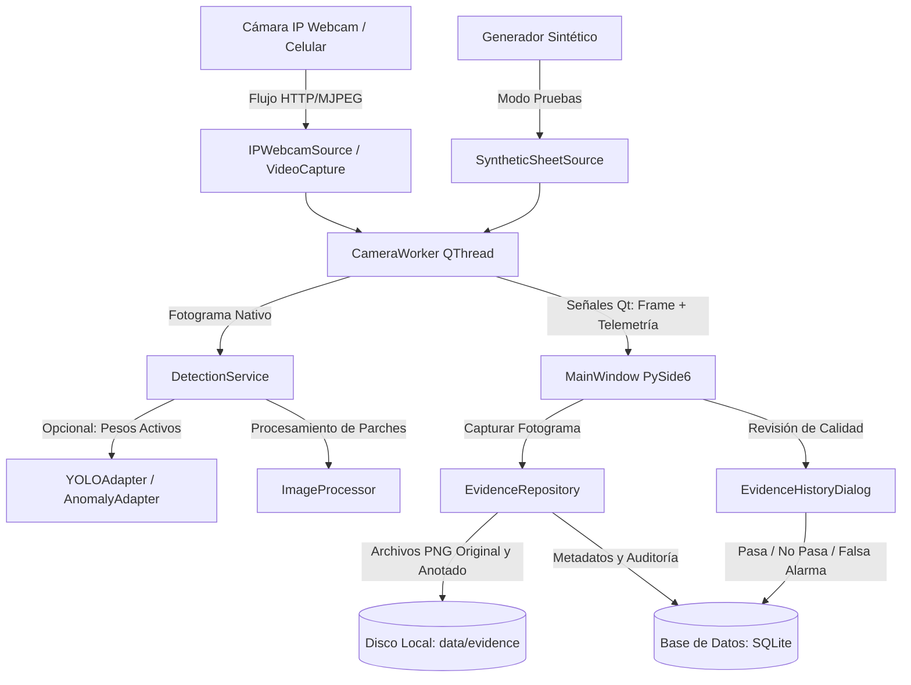

# Arquitectura del Sistema de Inspección

El sistema sigue una arquitectura modular en capas desacopladas, diseñada para operar en tiempo real sin bloquear la interfaz gráfica del operador y facilitando la incorporación de futuros modelos de visión industrial.

---

## 1. Diagrama de Flujo y Componentes

---

## 2. Descripción de Módulos

### `src/camera/`
- **`video_source.py`**: Clase abstracta `VideoSource` que define el contrato común (`open`, `read`, `is_opened`, `release`, `get_resolution`).
- **`ip_webcam_source.py`**: Implementación para IP Webcam mediante OpenCV con backend FFmpeg optimizado para minimizar latencia en streaming.
- **`synthetic_source.py`**: Emulador de láminas metálicas para validación continua de la UI, persistencia y pruebas unitarias sin requerir el celular encendido.
- **`stream_diagnostics.py`**: Comprobador escalonado de red (HTTP -> OpenCV -> decodificación de fotograma -> latencia) con emisión de diagnósticos y recomendaciones.

### `src/vision/`
- **`detection_service.py`**: Definición de interfaces (`VisionDetector`), regiones de interés (`DetectionRegion`) y resultados estructurados (`VisionInferenceResult`).
- **`yolo_adapter.py`**: Adaptador para Ultralytics YOLO. Comprueba la existencia real de los archivos de pesos `.pt` antes de habilitarse; no inventa datos.
- **`anomaly_adapter.py`**: Adaptador preparado para algoritmos no supervisados (PatchCore/Anomalib). Si no hay modelo entrenado, se declara explícitamente "No disponible".
- **`image_processor.py`**: Renderizado de anotaciones sin alterar la matriz original y particionamiento por teselas/parches (`extract_patches`) para inspección de alta resolución.

### `src/storage/`
- **`database.py`**: Gestor SQLite (`DatabaseManager`) para sesiones de inspección, evidencias, histórico de revisiones de calidad y bitácora de auditoría.
- **`evidence_repository.py`**: Gestor de persistencia física en disco (`data/evidence/YYYY-MM-DD/`) garantizando nombres únicos con timestamp y conservación de la imagen nativa sin compresión destructiva.

### `src/app/`
- **`camera_worker.py`**: Hilo de fondo `QThread` que ejecuta la lectura del flujo y la inferencia de visión, evitando cualquier congelamiento de la GUI.
- **`main_window.py`**: Interfaz de escritorio profesional con visualizador central no deformado, indicadores de telemetría y panel de control.
- **`history_dialog.py`**: Diálogo modal para la inspección de imágenes guardadas y registro formal del veredicto humano (`PASA`, `NO PASA`, `FALSA ALERTA`, `PENDIENTE`).
- **`settings.py`**: Almacenamiento persistente de configuraciones en `config/settings.json`.

### `src/utils/`
- **`logging_config.py`**: Configuración de rotación de logs (5MB, 3 copias) y sanitización de URLs para evitar registrar credenciales.
